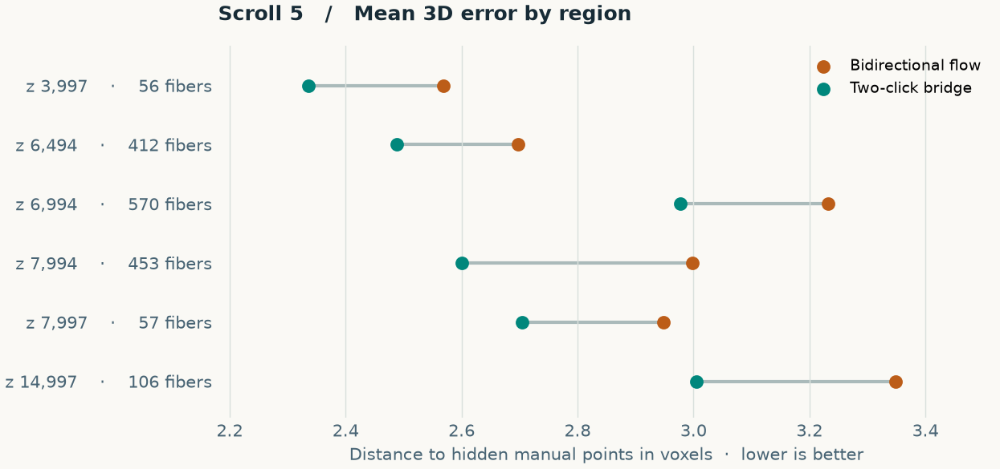

# Two-click papyrus fiber tracing

Trace a short fiber between two marks on the same strand of a carbonized papyrus CT. The application returns a three-dimensional centerline as a VC3D fiber JSON or WEBKNOSSOS NML. It uses a 0.47 MiB checkpoint learned on Scroll 1. On Scroll 5, mean distance to withheld manual fiber points fell from 3.010 to 2.723 voxels against bidirectional optical flow. All six evaluated regions showed a lower mean error.

In the Vesuvius Challenge workflow, a fiber can supply evidence that neighboring locations belong on the same papyrus sheet. A plausible strand that drifts onto a neighbor can supply a bad constraint. This tool lets an annotator propose a path over a short gap and inspect it before using that constraint. [Research problem: Fibers as connectivity clues](https://scrollprize.org/2026_open_problems#fibers-as-connectivity-clues)

## Run one trace

Use Python 3.10+ with the packages in `requirements.txt`. The tested system used Windows, Python 3.13.14 and an RTX 5080. A CPU path is also available. The bundled checkpoint is enough for inference. Download the public dataset from the authors under their data terms. The Scroll 5 command fetches six paired CT stacks and annotations. The annotation files are used only by the evaluation scripts.

```sh
python -m pip install -r requirements.txt
python fetch_data.py --split s5
python demo.py --out example_fiber.json
```

The demo selects the two endpoints of one published fiber and prints the local coordinates so you can use them in the CLI. The example has 34 subvoxel XYZ points. The two controls match the original endpoints in the full scan. The exported file was read by the [official VC3D fiber parser](https://github.com/ScrollPrize/villa/blob/9c1afbb1b97a3490156f828704aa706fe3f6cb85/vesuvius/src/vc3d_fiber_format/__init__.py). Its dense path agreed with the independently saved benchmark output within 0.001 voxel. For your own two clicks, pass the six XYZ values directly:

```sh
python trace_scroll.py crop.tif --start X1 Y1 Z1 --end X2 Y2 Z2 --origin X0 Y0 Z0 --out proposed.json
```

- **Input.** Use a single-channel multipage TIFF, with each image representing one Z slice. Pass clicks in X Y Z order relative to the crop. `--global-clicks` accepts full-volume positions. For another crop use `--origin X Y Z` to specify the full-volume origin. The public dataset filenames contain the origin, which is detected automatically.
- **VC3D.** Choose a `.json` output. The file contains typed version-4 fiber geometry, with both human controls and the dense estimate. For a level-zero scan, use `--volume-id ID` when the destination needs the official volume identifier. Inspect the proposed path against the source volume.
- **WEBKNOSSOS.** Choose a `.nml` output. NML nodes use integer voxel coordinates. When using the official TIFFs, the program infers the matching WEBKNOSSOS experiment and scale. For a different scan, supply `--experiment NAME --voxel-size-um SIZE`.
- **Integration.** From Python, `trace_scroll.trace(volume_zyx, start_xyz, end_xyz, predictor)` accepts an in-memory crop and returns the dense local path plus the mean displacement between its two estimates. Feed a crop with enough margin for the 18-voxel normal-plane radius. Use `Predictor(DEFAULT_MODEL)` once and reuse it for further clicks.
- **Review priority.** The distance moved by the second fit provides a rough order for manual inspection. A change above 0.67 voxels raises the priority. Both groups still contain errors. Check the centerline before using it to link sheets.

## What the tracer does

1. Extract 37 × 37 CT cross-sections perpendicular to the straight chord, about three voxels apart. Estimate forward and backward optical flow between sections.
2. Register neighborhood pairs at separations of one, two and four planes. Use these motion estimates together with a small 3D convolutional network trained to locate a strand using local CT texture and features at its two ends.
3. Solve for a path with both clicks fixed. Cut new cross-sections perpendicular to a smoothed version of this preliminary path. Recompute the motion estimates and fiber-location scores in the new sections, then fit a second path.
4. Average the two paths point by point. This option was selected on the separate Scroll 1 development cube before the Scroll 5 run. The bundled evaluation also reports the individual fits and the nonlearned controls.

## How it was evaluated

The source is the public Vesuvius Challenge fiber-skeleton release dated January 24, 2025. Four Scroll 1 regions supplied 1,797 overlapping training segments. A fifth Scroll 1 region, `s1_00497_02497_02997_256`, was reserved for development. It supplied 93 distinct eligible trees for comparison. No Scroll 5 cubes were used for training or model selection. The pre-test choices and source/checkpoint hashes are in `experiments/protocol.json`.

All six available Scroll 5 regions were then evaluated. The input to each tracer was the CT and two manual endpoints. Each annotated tree contributed one eligible segment picked by a deterministic hash from its unbranched portions, aiming for a 96-voxel chord in the 64–128 range. Each segment contained at least three original interior clicks. Endpoints were excluded from scoring. Distances were measured from each of 10,433 original interior clicks to the nearest point on the predicted 3D polyline, averaged per tree and then averaged across 1,654 trees. The reverse distance measures the interior predicted samples against the manual polyline.

| Scroll 5 result | Bidirectional flow | Two-click bridge |
| --- | ---: | ---: |
| Mean hidden-click error in voxels | 3.010 | 2.723 |
| Mean reverse error in voxels | 2.565 | 2.251 |
| Fibers with within-fiber 90th-percentile error above 5 voxels | 535 / 1,654 (32.3%) | 389 / 1,654 (23.5%) |
| Fibers with within-fiber 90th-percentile error at or below 3 voxels | 25.2% | 37.0% |

The straight chord scored 5.476 voxels and the multiscale registration plus endpoint-texture control scored 3.073. The primary comparator was bidirectional Farnebäck flow, with traces from the two ends blended by distance along the chord. The proposed path improved 1,071 paired cases and worsened 583. The 9.54% relative reduction refers to the mean error. The grouped counts and all six results are in `results/scroll5.json`. All 11 experimental variants, including the one-pass and unblended variants, appear in `results/all_methods.json`.

| Scroll 5 cube origin in source filename (Z, Y, X) | Fibers | Flow | Bridge |
| --- | ---: | ---: | ---: |
| 3997, 1497, 3997 | 56 | 2.569 | 2.336 |
| 6494, 1994, 3994 | 412 | 2.698 | 2.489 |
| 6994, 994, 4994 | 570 | 3.232 | 2.977 |
| 7994, 1994, 5494 | 453 | 2.998 | 2.600 |
| 7997, 2997, 5497 | 57 | 2.949 | 2.704 |
| 14997, 1497, 1497 | 106 | 3.348 | 3.004 |



The fixed review threshold placed 639 of 1,654 fibers in the lower-priority group. Of those, 91 (14.2%) still exceeded the five-voxel tail threshold, compared with 298 of 1,015 (29.4%) in the higher-priority group. As an exploratory observation, using only the second fit scored 2.625 voxels on this test set. Confirming that variant would require another independent test.

## Reproduce the comparison and figure

```sh
python fetch_data.py --split all
python experiment.py --split s5 --model weights/fiber_long_s1.pt --strengths 1 --neural-strengths 0.35 --workers 4 --refit --output experiments/heldout
python analyze.py --input experiments/heldout --output results/scroll5.json
python make_figure.py --input experiments/heldout --output evidence/scroll5_results.png
```

The figure displays CT with the actual paths and hidden points for the cases closest to the 95th and 5th percentiles of paired improvement. The choice is numeric and reproducible. Reviewers can regenerate it directly from the public source. For retraining, use the same sorted official files and run the following from the project directory. Training augmentations use seed 418. Library and GPU versions can cause small numerical differences. The supplied weights reproduce the evaluated checkpoint directly.

```sh
python train.py --steps 1550 --batch 8 --valid-cube 1 --seed 418 --out weights/fiber_long_s1.pt
python experiment.py --split s1 --cube s1_00497_02497_02997_256 --model weights/fiber_long_s1.pt --strengths 1 --neural-strengths 0.35 --workers 4 --refit --output experiments/dev-curved
```

## Limits of the evidence

The two clicks must belong to the same fiber. The useful range studied here is short, and only one scroll was evaluated independently of development. The manual interiors are sparse and have their own annotation error. A close centerline can still follow the wrong neighboring fiber. Same-sheet connectivity, recovered letters, operator time savings and whole-scroll performance were not measured. The production VC3D Lasagna/native tracer requires additional fiber and normal manifests; this release has no head-to-head against that tracer. The example confirms format readback with the official parser. GUI use by a human annotator remains untested.

## Data and credit

Scroll 1 data used in this research come from EduceLab-Scrolls. Credit for the CT and manual annotations belongs to the original data contributors. Download the CT volumes and manual traces from the original hosts. This research package contains code, model weights and aggregate measurements. Local diagnostic images and per-tree paths can be regenerated after obtaining the data.

- [Vesuvius Challenge data catalog](https://scrollprize.org/data_datasets) and [original fiber-skeleton release](https://dl.ash2txt.org/datasets/fiber-skeletons/Dataset001_sk-fibers-20250124/)
- [Vesuvius Challenge data terms](https://dl.ash2txt.org/LICENSE.txt)
- Parsons, S., Parker, C. S., Chapman, C., Hayashida, M., and Seales, W. B. (2023). *EduceLab-Scrolls: Verifiable Recovery of Text from Herculaneum Papyri using X-ray CT*. [Paper](https://doi.org/10.48550/arXiv.2304.02084)
